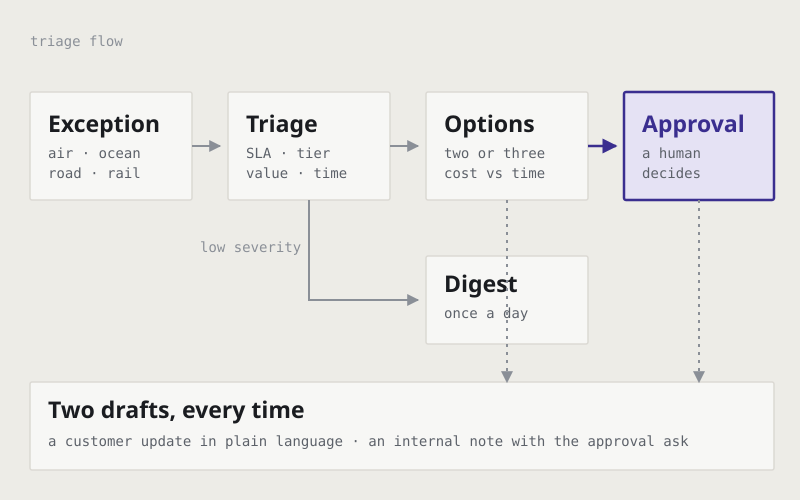

# DSV Shipping Exception Agent

An agentic teammate for a freight forwarding operations team. It watches for
customer-impacting shipping exceptions across air, ocean, road and rail, scores
how bad each one is, and drafts the two messages a coordinator would otherwise
write by hand. It never commits money or contacts a customer on its own.

Built on **Fleet (LangChain)** with Slack tools over MCP, as an individual
project for Applied AI for Entrepreneurship at DTU, autumn 2026.



## The problem

In freight forwarding, exceptions are routine: a missed connection, a customs
hold, a capacity shortfall, a damaged pallet, a document mismatch. What makes
them expensive is not the exception itself but the delay before someone notices
and decides. By the time a customer calls to ask where their shipment is, the
recovery options have usually narrowed and the cheap ones are gone.

The operational bottleneck is not information. It is the coordinator's
attention, spread across many shipments at once.

## What the agent does

**Scans every twenty minutes** (`*/20 * * * *`), and also wakes on a Slack
mention, a direct message, or a new reply in a thread it is already part of.

**Scores severity** as High, Medium or Low on four axes:

| Axis | Why it matters |
| --- | --- |
| SLA breach risk | Will the contracted delivery window be missed? |
| Customer tier | Strategic accounts escalate one level faster |
| Cargo value and sensitivity | High-value, temperature-controlled or hazardous cargo escalates to at least Medium automatically |
| Time to impact | Hours-to-impact and days-to-impact are different problems |

The scoring is mode-aware. Air delays are measured in hours and customs holds at
large hubs escalate faster than at small airports. Ocean delays are measured in
days and the usual causes are capacity and port congestion. Road exceptions are
often recoverable same day by rerouting. Rail recovery is usually limited to the
next available slot.

**Generates two or three ranked resolution options** for every Medium or High
case, safest first, each with its cost and time trade-off: reroute via an
alternative carrier or mode, expedite on the current route, split the shipment
to protect the time-critical part, or hold and ask the customer for
instructions. Never one option alone unless the situation is genuinely
unambiguous.

**Writes two separate drafts**, every time, even while the case is still open:

- a **customer update** in plain language, which says what happened, what is
  being done and what to expect next, in that order, with no internal system
  names and no jargon
- an **internal Slack note** that states the case, the recommended option, the
  cost and time impact, and exactly what approval is needed

**Batches the quiet cases.** Low-severity exceptions do not interrupt anyone
individually. They are collected into one daily digest.

## The design decision worth explaining

Nothing that commits a cost, an SLA, or contact with a customer executes without
a person saying yes. The agent prepares and recommends; a human decides. The
approval gate is not a safety afterthought bolted on at the end: it is the
boundary the whole workflow is built around, which is why the agent always
produces a draft plus an approval ask rather than an action.

There is a second constraint in the same spirit: human attention is treated as a
scarce resource. The agent posts at most one message per exception unless there
is genuinely new information, and prefers one daily digest to a stream of
individual low-priority updates. An assistant that reports everything is a
notification system, not a teammate.

## How it is built

The agent is written as instructions and a skill rather than as application
code. The behaviour lives in Markdown, which means the triage policy can be read
and changed by an operations person, not only by a developer.

```
AGENTS.md                                identity, scope, workflow, escalation rules
skills/shipping-exception-triage/
  SKILL.md                               severity scoring, mode-specific notes,
                                         resolution options, message templates
config.json                              schedule, model, triggers
tools.json                               the Slack tools available over MCP
docs/triage-flow.svg                     the diagram above
```

The toolbox is deliberately narrow. The agent can send a channel message and
reply in a thread. It cannot send private messages or files, so every decision
stays visible in the shared channel.

## Running it

This is a Fleet agent configuration, not a standalone program. To run it:

1. Create an agent in Fleet and point it at this repository.
2. Connect a Slack workspace and grant the tools listed in `tools.json`.
3. Fill in the placeholders in `config.json`: `ls_user_id`, `organization_id`,
   `tenant_id` and `slack_oauth_provider_id` are specific to your own
   deployment, and the two `triggers` ids are created when you set up the
   scheduled scan and the Slack trigger.
4. Adjust the severity thresholds in `skills/shipping-exception-triage/SKILL.md`
   to your own SLA terms and customer tiers before using it on real shipments.

## Limitations

It is a prototype. The severity thresholds are reasoned from the domain rather
than calibrated against a real exception history, so they are a starting point
for tuning, not a validated policy. The cost and time trade-offs in the
resolution options are estimates the agent reasons about, not figures pulled
from a rate system. And it has not been evaluated against how a human
coordinator would actually have triaged the same cases, which is the experiment
that would tell you whether the scoring is any good.

## Note

The domain and the scenario come from a university project carried out with DSV
as the case company. No DSV data, customer information or internal system access
is included in this repository.
